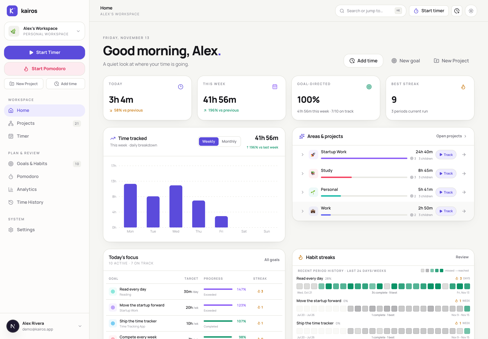
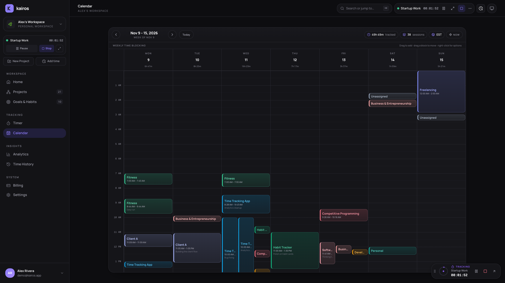
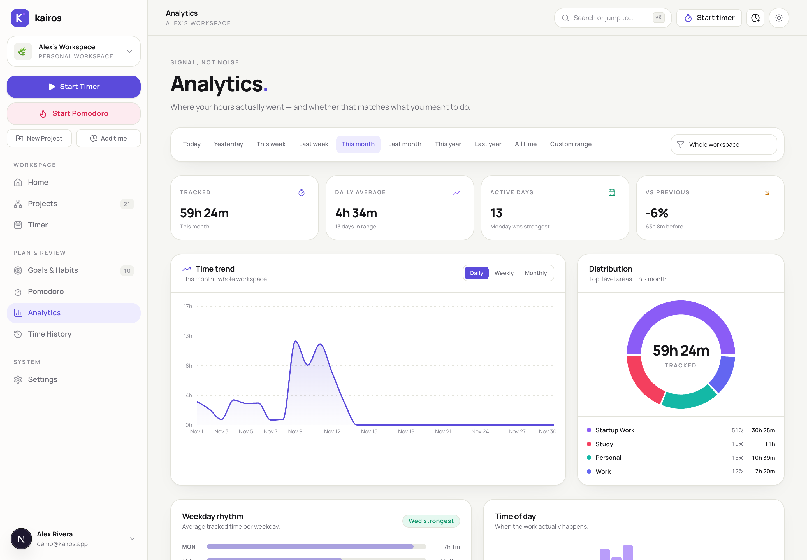

# Kairos

### Time well spent.

Kairos is a personal productivity workspace built around a simple idea: **if something matters, give it time, track that time, and watch your consistency add up.**

It combines flexible project organization, frictionless time tracking, independent time-based goals, habit streaks, Pomodoro focus blocks, a weekly time-blocking calendar, and calm analytics into one polished workspace — dark by default.

**[Live demo →](https://kairos-lime-three.vercel.app)** · `demo@kairos.app` / `demo1234`

<p>
  
  
  
  
  
</p>



## Why Kairos

Most time trackers answer “how many hours did I work?” Kairos tries to answer better questions:

- How much time did I invest in my startup this week?
- Which project has been getting neglected?
- Am I actually reading every day, or only intending to?
- Is my time aligned with the priorities I chose?
- How has my allocation changed over the last six months?

Time is the unit of progress here — not task checkboxes or vague productivity scores.

## Screenshots

### Track your week, block by block

A weekly Google Calendar–style view of every time entry, with overlapping sessions, overnight splitting, a live current-time line, and click-to-edit blocks.



### Goals that stay independent at every level

Daily, weekly, monthly, and custom targets on any item. Parent and child goals never constrain each other, and every day of the month is visible in a spreadsheet-style grid.


### Analytics that explain where the hours went

Time distribution, daily/weekly/monthly trends, weekday rhythm, time-of-day patterns, goal health, and habit consistency.



## Features

### Flexible hierarchy
- Unlimited-depth items — areas, projects, custom items, or unclassified
- Create, edit, nest, move, reorder, archive, restore, and safely delete
- Table-style Projects page with weekly totals, goal counts, and sub-item counts
- Drag one item onto another to nest it
- Parent totals automatically include every descendant, counted exactly once

### Time tracking
- One server-authoritative timer per user
- Start immediately with no project, then assign or change the project later
- Pause, resume, stop, and edit the running project
- Timestamps are authoritative — timing stays accurate across navigation, refreshes, and browser restarts
- Manual entries with date, optional start time, duration, and description
- Unassigned time is preserved rather than silently discarded
- Table-based history plus a calendar view
- Edit or delete any entry, with totals and goals recalculated immediately

### Goals, habits, and streaks
- Independent goals on any item at any depth
- Daily, weekly, monthly, and custom date-range periods
- Scheduled weekdays, reminders, and preserved target history
- Progress, pace, remaining time, completion status, streaks, and consistency
- GitHub-style habit history with distinct shades for completion and missed periods
- Spreadsheet view for reviewing every day of a month

### Pomodoro **Pro**
- Focus, short-break, and long-break phases
- Configurable durations, rounds before a long break, auto-start options, and sound cues
- Starts instantly from the sidebar or workspace
- Live timer in the sidebar, navbar, and a draggable floating widget
- Movable, resizable floating window with a 60-minute regular timer dial too
- Focus-only time saved to history as Pomodoro sessions
- Custom duration editing mid-session

### Weekly calendar
- Google Calendar–style weekly time-blocking grid
- Time entries placed by actual start/end time
- Side-by-side layout for overlaps
- Overnight entries split across days
- Week navigation and current-time indicator
- Automatically uses the browser’s current timezone — no GPS permission

### Dashboard and analytics
- Today’s time, weekly trend, goal-directed percentage, and best streak (free)
- **Advanced analytics is Pro:** distribution, weekday rhythm, time-of-day, goal health, and item reports
- Compact all-goals table with expansion
- Expandable Areas & Projects tree
- Table-style recent sessions and a habit-history grid
- Time distribution, trends, weekday rhythm, time-of-day patterns
- Goal completion health and habit consistency
- Item-level analytics with drill-down

### Platform
- **Dark mode by default**, with light and system themes
- Responsive layouts for desktop, tablet, and mobile
- Command palette (`⌘K` / `Ctrl+K`)
- Accessible dialogs and menus with Radix UI
- JSON data export
- In-app reminders and clear empty states
- Email verification and password reset links (Resend)
- Hashed, single-use auth tokens with expiry and resend cooldowns

## Accounts and email

Signups create an unverified account by default **when an email provider is configured**:

1. A 24-hour verification link is emailed after signup.
2. Unverified accounts can't log in until the link is opened.
3. Opening the link verifies the account and signs the user in.
4. Resending is rate-limited and always stays generic.

Forgot-password links are single-use, expire after one hour, and are only sent for real accounts
without revealing whether an email exists.

Email delivery uses [Resend](https://resend.com). Configure:

```env
RESEND_API_KEY="re_..."
EMAIL_FROM="Kairos <hello@your-domain.com>"
```

Once both `RESEND_API_KEY` and `EMAIL_FROM` are set, verification is enforced automatically. Existing accounts are
backfilled as verified by the migration so nobody is locked out. If no provider is configured,
signups keep working without verification so a missing mail credential can't block the app.
`EMAIL_FROM` must use a domain verified in Resend, such as `Kairos <hello@your-domain.com>`.
The free `onboarding@resend.dev` sender only delivers to the Resend account owner's own inbox, so
it is not suitable for real signups.

For local testing without Resend, set `REQUIRE_EMAIL_VERIFICATION="true"` and the verification
and reset links will be printed in the development server log.

## Plans

Kairos is free for everyday time tracking, with an optional Pro plan.

| | Free | Pro |
| --- | --- | --- |
| Timers, manual entries, sessions | ✓ | ✓ |
| Flexible projects and hierarchy | ✓ | ✓ |
| Weekly timer calendar | ✓ | ✓ |
| Dashboard and core goals | ✓ | ✓ |
| Active items | 5 | Unlimited |
| Active goals | 3 | Unlimited |
| Pomodoro | — | ✓ |
| Advanced analytics | — | ✓ |

The seeded demo account is Pro so every screen is visible.

## Billing setup (Lemon Squeezy)

Payments are optional; the app runs normally without them. To enable Pro checkout:

1. Create a **Lemon Squeezy** store.
2. Create a product with **two subscription variants**: monthly and yearly.
3. Create an API key and copy the store ID and variant IDs.
4. Add the environment variables below.
5. Add a webhook pointing to `https://YOUR_DOMAIN/api/webhooks/lemonsqueezy`.
6. Subscribe the webhook to subscription events (created, updated, cancelled, resumed, expired, paused, unpaused, payment success/failure).
7. Run `pnpm db:migrate` (or `prisma migrate deploy` in production).

```env
LEMON_SQUEEZY_API_KEY=""
LEMON_SQUEEZY_STORE_ID=""
LEMON_SQUEEZY_MONTHLY_VARIANT_ID=""
LEMON_SQUEEZY_YEARLY_VARIANT_ID=""
LEMON_SQUEEZY_WEBHOOK_SECRET=""
NEXT_PUBLIC_APP_URL="https://your-domain.com"

# Optional display values on the billing page
NEXT_PUBLIC_PRO_MONTHLY_PRICE="$8"
NEXT_PUBLIC_PRO_YEARLY_PRICE="$80"
```

Billing flow:

- `POST /api/webhooks/lemonsqueezy` verifies the `X-Signature` HMAC before writing anything.
- Checkout custom data carries `user_id` and `workspace_id`, with email/customer fallback matching.
- Subscriptions remain Pro until `ends_at` when cancelled.
- Active subscribers can cancel from **Plan & Billing**; access continues through the paid period.
- Checkout and subscription management are hosted by Lemon Squeezy; card data never touches Kairos.

## Quick start

### Prerequisites

- Node.js **20.9+**
- pnpm **10+**
- PostgreSQL running locally

### Setup

```bash
pnpm install
cp .env.example .env
```

Create a database and configure `.env`:

```bash
createdb timetracker
```

```env
DATABASE_URL="postgresql://YOUR_USER@localhost:5432/timetracker?schema=public"
SESSION_SECRET="run: openssl rand -base64 32"
```

Apply migrations and seed the demo workspace:

```bash
pnpm db:migrate
pnpm db:seed
pnpm dev
```

Open [http://localhost:3000](http://localhost:3000).

### Live demo

**https://kairos-lime-three.vercel.app**

```text
Email:    demo@kairos.app
Password: demo1234
```

The login screen also has an **Open the demo workspace** button.

## Architecture

- **Next.js 16** App Router, React Server Components, Server Actions
- **TypeScript**
- **Tailwind CSS 4** with a custom token-based design system
- **PostgreSQL + Prisma 6**
- **jose** JWT sessions in HTTP-only cookies
- **bcryptjs** password hashing
- **Recharts** for charts
- **Radix UI** for accessible primitives
- **date-fns / date-fns-tz** for timezone-aware periods and attribution

### Project structure

```text
prisma/
  schema.prisma        # User, Workspace, Item, Goal, TimeSession, TimerState, BillingAccount
  seed.ts              # Realistic demo workspace

src/
  app/
    (auth)/            # Login and signup
    (app)/
      dashboard/       # Daily overview
      workspace/       # Projects hierarchy
      calendar/        # Weekly time-blocking calendar
      goals/           # Goals & habits spreadsheet
      pomodoro/        # Full Pomodoro experience
      analytics/       # Reports and insights
      history/         # Session table and calendar
      items/[id]/      # Item detail + item analytics
      settings/        # Profile, workspace, preferences, security
      billing/         # Plans, checkout, subscription status
    actions/           # Server Actions (auth, timer, goals, billing, settings)
    api/auth/          # Email verification callback
    api/export/        # JSON export
    api/webhooks/      # Lemon Squeezy webhook
  components/          # UI, charts, dialogs, timer, calendar, dashboards
  lib/                 # Auth, email, timezone/time math, goals, analytics, Prisma
```

### Time attribution

A session belongs to exactly one item. For aggregates, its time rolls up through every ancestor. Goals attached anywhere on that path include it. A parent total never double-counts its children, but the same session can legitimately contribute to independent goals at multiple levels.

```text
Startup Work                     20h / 20h target
  Habit Tracker       8h          ← this time also counts toward Startup Work
  Time Tracking App   7h
  House Rental App    5h
```

### Data model

```text
User ─── Workspace ─── Item (self-referencing, unlimited depth)
               │          ├── TimeSession
               │          └── Goal (target history preserved)
               └── TimeSession
User ─── TimerState (one active timer per user)
```

## Scripts

| Command | Description |
| --- | --- |
| `pnpm dev` | Start the development server |
| `pnpm build` | Production build |
| `pnpm start` | Start the production server |
| `pnpm lint` | Run ESLint |
| `pnpm db:migrate` | Create/apply a development migration |
| `pnpm db:push` | Push the schema without a migration |
| `pnpm db:seed` | Reset and seed the demo workspace |
| `pnpm db:studio` | Open Prisma Studio |
| `pnpm db:generate` | Regenerate Prisma Client |

## Environment variables

| Variable | Required | Purpose |
| --- | --- | --- |
| `DATABASE_URL` | Yes | PostgreSQL connection string |
| `SESSION_SECRET` | Yes | HS256 signing key for session cookies |
| `LEMON_SQUEEZY_API_KEY` | For billing | Lemon Squeezy API key |
| `LEMON_SQUEEZY_STORE_ID` | For billing | Store ID |
| `LEMON_SQUEEZY_MONTHLY_VARIANT_ID` | For billing | Monthly subscription variant |
| `LEMON_SQUEEZY_YEARLY_VARIANT_ID` | For billing | Yearly subscription variant |
| `LEMON_SQUEEZY_WEBHOOK_SECRET` | For billing | Webhook signing secret |
| `NEXT_PUBLIC_APP_URL` | Recommended | Redirect base URL for checkout and email links |
| `RESEND_API_KEY` | For email | Resend API key; enables verification and reset emails |
| `EMAIL_FROM` | For email | Verified sender, e.g. `Kairos <hello@your-domain.com>` |
| `REQUIRE_EMAIL_VERIFICATION` | Optional | Force verification locally without a provider |

## Notes

- The MVP is designed for one personal workspace per user.
- Timer state and completed sessions are persisted in PostgreSQL.
- Pomodoro run state is persisted locally and reconciled against timestamps; completed focus blocks are saved to the database.
- The web app is structured so mobile and desktop clients can share the same API and data model later.
